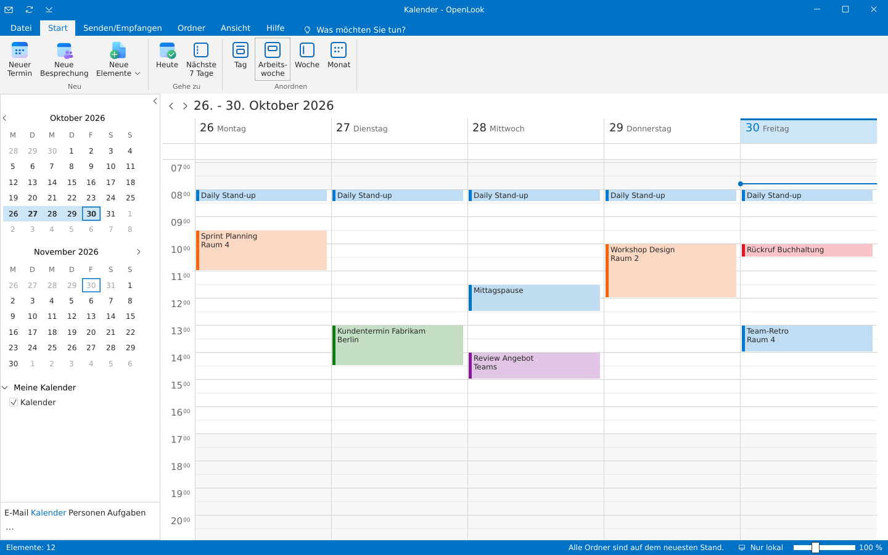
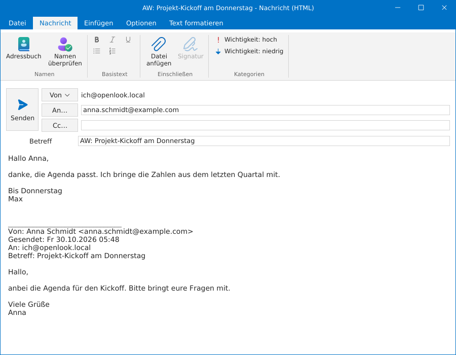
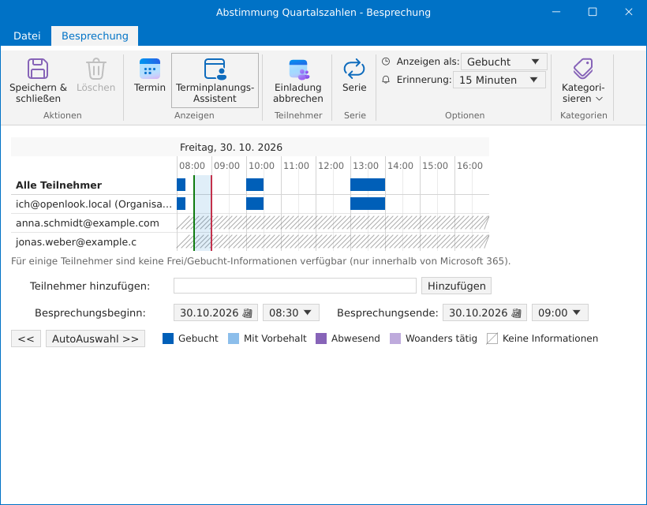
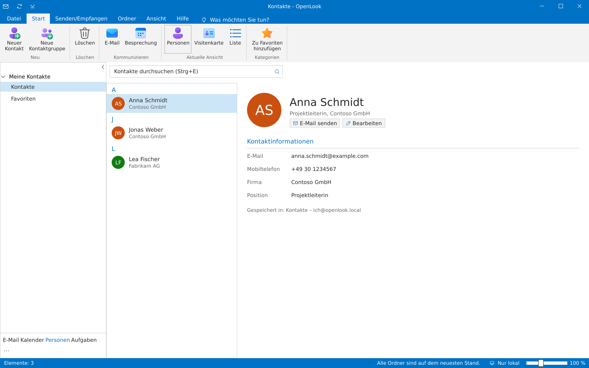
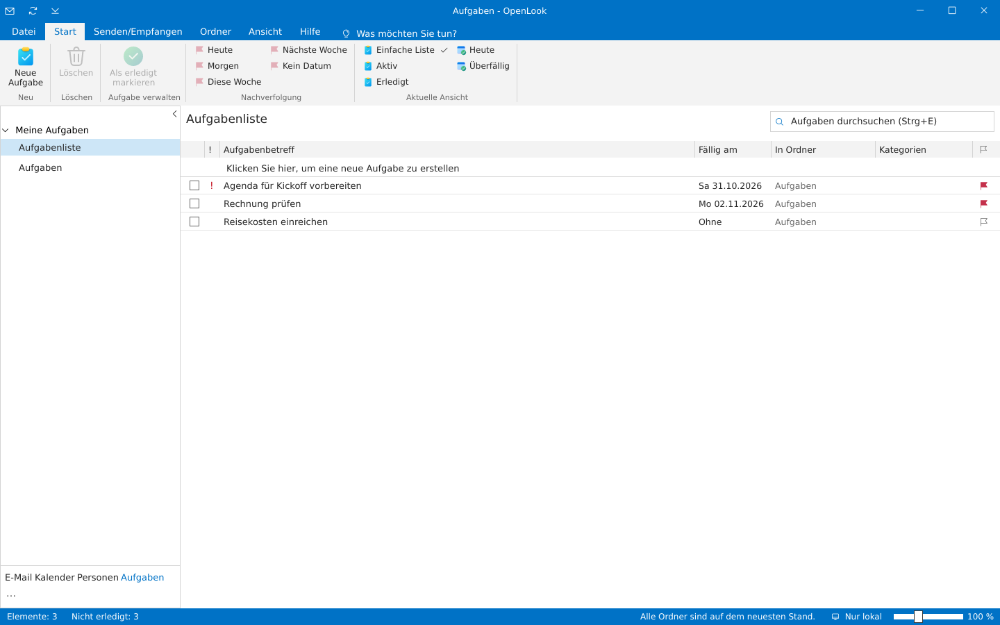

<div align="center">

# OpenLook

**Ein freier Klon eines bekannten Mail-Clients – E-Mail, Kalender, Kontakte und Aufgaben in einem Desktop-Programm.**

Ein einziges natives Programm in Rust · kein Server · kein Browser · gemeinfrei (Unlicense)


</div>

> [!WARNING]
> **OpenLook ist noch ungetestet.** Das Programm ist bisher nicht im Alltag erprobt und nur in einer Testumgebung gelaufen (Linux; Windows-Version unter Wine; IMAP/SMTP gegen einen lokalen Testserver; Microsoft 365 nur gegen einen nachgebauten Server). Mit einem echten Microsoft-365-Konto, auf echtem Windows und auf macOS wurde es noch nie ausprobiert. Bitte nicht als einziges Programm für wichtige Postfächer verwenden und vorher Sicherungen anlegen. Fehlerberichte sind willkommen.

## Warum OpenLook?

* **Vertraut ab der ersten Minute** – Menüband, Ordnerbereich, Nachrichtenliste, Lesebereich, Backstage, eigene Fenster für Nachrichten und Termine, dieselben Tastenkürzel (`Strg+N`, `Strg+R`, `F9` …) wie beim Vorbild.
* **Alles in einem Programm** – E-Mail, Kalender mit Terminplanungs-Assistent, Personen mit Kontaktgruppen, Aufgaben, Notizen und Journal.
* **Jedes Postfach** – IMAP/SMTP (Gmail, GMX, WEB.DE, T-Online, Posteo, mailbox.org, iCloud …) und Microsoft 365 / Outlook.com über Microsoft Graph, auch freigegebene Postfächer.
* **Schnell und sparsam** – eine einzelne ausführbare Datei, lokaler SQLite-Cache, Netzwerkzugriffe im Hintergrund; Kennwörter im Schlüsselbund des Betriebssystems.
* **Frei** – gemeinfrei: Jeder darf damit machen, was er will, ohne Bedingungen. Keine Telemetrie, keine Werbung.

## Screenshots

| | |
|:---:|:---:|
| <br>**Kalender** – Arbeitswoche, Datumsnavigator, Kategorien | <br>**Nachricht verfassen** – eigenes Fenster mit Menüband |
| <br>**Terminplanungs-Assistent** – Frei/Gebucht und AutoAuswahl | <br>**Personen** – Kontakte, Visitenkarten, Kontaktgruppen |
| <br>**Aufgaben** – Nachverfolgung und Ansichten | |

## Schnellstart

```sh
git clone <dieses Repository> openlook && cd openlook
cargo run --release
```

OpenLook startet mit einem lokalen Postfach samt Beispieldaten. Ein echtes Konto fügst du über *Datei → Konto hinzufügen* hinzu. Das Ergebnis von `cargo build --release` ist eine einzelne Datei (`target/release/openlook`, unter Windows `openlook.exe`).

## Funktionen im Überblick

### Oberfläche

* **Eigene Titelleiste** mit Symbolleiste für den Schnellzugriff (Senden/Empfangen, Menüband ein/aus), Fenstertitel „Posteingang - konto - OpenLook“, Minimieren/Maximieren/Schließen.
* **Menüband** mit Registerkarten *Datei · Start · Senden/Empfangen · Ordner · Ansicht · Hilfe*, Gruppen mit großen und kleinen Schaltflächen, Drop-down-Menüs und „Was möchten Sie tun?“; die Registerkarte *Suchen* erscheint während einer Suche (Bereich, Optimieren: Anlagen, gekennzeichnet, wichtig, ungelesen, kategorisiert). Symbole aus den Fluent UI System Icons von Microsoft wie im Office-Menüband.
* **Datei-Backstage**: Kontoinformationen, Konto hinzufügen, Kontoeinstellungen (synchronisieren, entfernen), Postfachtools („Gelöschte Elemente“ leeren), Optionen, Beenden.
* **Ordnerbereich** mit Favoriten, Ordnerbaum pro Konto (Ungelesen-Zähler, Entwürfe in [ ]) und Suchordnern (Ungelesene E-Mail, Zur Nachverfolgung gekennzeichnet, E-Mail mit Anlagen, Wichtige E-Mail), minimierbar, unten die Modulleiste *E-Mail · Kalender · Personen · Aufgaben*.
* **To-Do-Leiste** (Ansicht → To-Do-Leiste): Kalender mit kommenden Terminen, Personen-Favoriten und Aufgaben.
* **Statusleiste** mit Elemente/Ungelesen, Sync-Status, Verbindungsstatus und Zoom-Regler.
* **Eigene Betriebssystem-Fenster** wie beim Vorbild für: Nachricht lesen, Nachricht verfassen, Termin/Besprechung, Kontakt, Aufgabe, Optionen, Konto hinzufügen und Erinnerungen.
* Designs **Bunt** und **Schwarz**.

### Module

| Modul | Funktionen |
|---|---|
| **E-Mail** | HTML-Anzeige (fett, kursiv, Links, Überschriften, Listen, Zitate, Tabellen), Anlagen öffnen/speichern/alle speichern, Unterhaltungsansicht, Ordnerbaum mit Unterordnern, Ordner anlegen/umbenennen/löschen, öffentliche/freigegebene IMAP-Ordner, Regeln, Drucken (`Strg+P`), Nachrichtenliste mit Gruppen (Heute, Gestern, Wochentag, Letzte Woche …), Alle/Ungelesen, Sortierung nach Datum/Von/Betreff, Suche im aktuellen Ordner oder in allen Postfächern, Lesebereich rechts/unten/aus, Nachrichtenvorschau, Antworten/Allen antworten/Weiterleiten, Löschen → „Gelöschte Elemente“, Archivieren, Junk-E-Mail, Verschieben (auch per Drag & Drop), Ungelesen/Gelesen, Kategorien, Zur Nachverfolgung, Anheften, Doppelklick öffnet die Nachricht im eigenen Fenster, Original-HTML im Browser, QuickSteps (Verschieben in, An Vorgesetzte(n), Team-E-Mail, Erledigt, Antworten und löschen, eigene QuickSteps), Ignorieren und Aufräumen von Unterhaltungen |
| **Verfassen** | Formatierung (fett, kursiv, unterstrichen, Aufzählung, Nummerierung – wird beim Tippen formatiert angezeigt und als HTML gesendet), Datei anfügen, Weiterleiten mit Anlagen, Senden-Schaltfläche links, Von/An/Cc/Bcc, Adressbuch, Namen überprüfen, AutoVervollständigen aus den Kontakten, Kontaktgruppen, Signatur, Wichtigkeit hoch/niedrig, Lesebestätigung/Übermittlungsbestätigung, „Antworten an“, Übermittlung verzögern („Nicht senden vor“, über den Postausgang), Visitenkarte einfügen, Entwürfe, Speichern als .eml, Nachfrage „Änderungen speichern?“ |
| **Kalender** | Datumsnavigator (zwei Monate), Tag/Arbeitswoche/Woche/Monat, Heute, Nächste 7 Tage, Arbeitszeit hervorgehoben, Jetzt-Linie, überlappende Termine nebeneinander, ganztägige Ereignisse, Kalender ein-/ausblenden, Termin und Besprechung (Teilnehmer), Terminplanungs-Assistent (Frei/Gebucht-Raster für Organisator und Teilnehmer, AutoAuswahl des nächsten freien Zeitraums, Termin per Klick ins Raster verschieben; Teilnehmer über Microsoft 365 `getSchedule`), Serientermine (täglich, wöchentlich mit Wochentagen, monatlich, jährlich, mit/ohne Enddatum), Besprechungsanfragen annehmen/mit Vorbehalt/ablehnen (Microsoft 365), Anzeigen als, Erinnerung, Kategorien |
| **Regeln** | „Regeln und Benachrichtigungen“: Bedingung (Absender, Betreff, Empfänger, Text enthält) → Aktion (verschieben, als gelesen markieren, kennzeichnen, Kategorie, löschen); gelten für neue Nachrichten nach jedem Senden/Empfangen, „Regeln jetzt anwenden“ für den ganzen Posteingang |
| **Automatische Antworten** | Abwesenheitsnotiz mit Zeitraum; Microsoft 365 mit getrennten Texten für intern/extern, IMAP-Konten über ManageSieve (Sieve „vacation“, z. B. Dovecot/Pigeonhole, Cyrus, mailbox.org, Posteo) |
| **Erinnerungen** | Erinnerungsfenster mit „Alle schließen“, „Element öffnen“, „Schließen“ und „Erneut erinnern“ |
| **Personen** | Ansichten Personen, Visitenkarte und Liste; Kontaktfenster mit Visitenkarten-Vorschau; Favoriten; Kontaktgruppen (Verteilerlisten) mit eigenem Fenster, im An-Feld als Vorschlag und beim Senden aufgelöst; E-Mail/Besprechung an Kontakt |
| **Notizen** | Haftnotizen in eigenen farbigen Fenstern, speichern sich selbst; Ansichten Symbol und Notizenliste; Farben |
| **Journal** | Journaleinträge (Telefonanruf, Besprechung, E-Mail-Nachricht, Aufgabe, Dokument, Gespräch, Notiz) mit Zeitgeber, Liste nach Eintragstyp |
| **Aufgaben** | Tabellenansicht mit „Klicken Sie hier, um eine neue Aufgabe zu erstellen“, Fällig am, In Ordner, Nachverfolgung (Heute, Morgen, Diese Woche, Nächste Woche, Kein Datum), Ansichten Einfache Liste/Aktiv/Erledigt/Heute/Überfällig, Aufgabenfenster |

Tastenkombinationen wie beim Vorbild: `Strg+N` neues Element, `Strg+R` / `Strg+Umschalt+R` antworten / allen antworten, `Strg+F` weiterleiten, `Entf` löschen, `Strg+Q` / `Strg+U` gelesen / ungelesen, `Einfg` kennzeichnen, `Strg+E` suchen, `Alt+S` senden, `Strg+1…4` Module, `Strg+5` Notizen, `Strg+8` Journal, `Strg+B/I/U` fett/kursiv/unterstrichen, `Strg+P` drucken, `F9` Senden/Empfangen, `Strg+F1` Menüband. Notizen und Journal erreicht man über „···“ in der Modulleiste.

## Konten

* **Lokales Postfach** – immer vorhanden, mit Beispieldaten; funktioniert komplett offline.
* **IMAP/SMTP** – jedes Postfach; für Gmail, GMX, WEB.DE, T-Online, iCloud, Posteo, Yahoo, mailbox.org, freenet und AOL werden die Server automatisch eingetragen. IMAP über SSL/TLS (993), SMTP über STARTTLS (587) oder SSL/TLS (465). Kalender, Kontakte und Aufgaben werden bei IMAP-Konten lokal gespeichert.
* **Microsoft 365 / Outlook.com** – über Microsoft Graph: E-Mail (mit Unterordnern), Kalender, Kontakte und Microsoft To Do werden synchronisiert; Änderungen gehen direkt an den Server.
* **Freigegebene Postfächer (Microsoft 365)** – *Datei → Kontoeinstellungen → Freigegebenes Postfach hinzufügen…*; erscheinen als eigenes Postfach im Ordnerbereich (E-Mail, Kalender, Kontakte) und nutzen die Anmeldung des eigenen Kontos.

### Microsoft-Anmeldung einrichten

OpenLook nutzt den OAuth-Gerätecode-Flow (kein Redirect, kein Client-Secret):

1. Im [Entra Admin Center](https://entra.microsoft.com) → *App-Registrierungen* → *Neue Registrierung*.
   Kontotyp: „Konten in einem beliebigen Organisationsverzeichnis und persönliche Microsoft-Konten“.
2. Unter *Authentifizierung* „Öffentliche Clientflows zulassen“ aktivieren.
3. Unter *API-Berechtigungen* (Microsoft Graph, delegiert) hinzufügen:
   `User.Read Mail.ReadWrite Mail.Send Calendars.ReadWrite Contacts.ReadWrite Tasks.ReadWrite MailboxSettings.ReadWrite offline_access`,
   für freigegebene Postfächer zusätzlich `Mail.ReadWrite.Shared Mail.Send.Shared Calendars.ReadWrite.Shared Contacts.ReadWrite.Shared`.
4. Die *Anwendungs-ID (Client-ID)* als Umgebungsvariable setzen und OpenLook starten:

```sh
export OPENLOOK_GRAPH_CLIENT_ID=<client-id>
cargo run --release
```

Dann *Datei → Konto hinzufügen → Erweiterte Optionen → Microsoft 365*, den angezeigten Code auf der Microsoft-Seite eingeben – fertig.

## Bauen

Voraussetzung ist ein aktuelles [Rust](https://rustup.rs) (stable). Bisher nur unter Linux und als Windows-Version unter Wine gestartet; macOS sollte ebenso bauen, wurde aber noch nie ausprobiert.

Windows-Programm von Linux aus bauen (MinGW):

```sh
rustup target add x86_64-pc-windows-gnu
sudo apt install gcc-mingw-w64-x86-64
cargo build --release --target x86_64-pc-windows-gnu   # → target/x86_64-pc-windows-gnu/release/openlook.exe
```
 Unter Windows wird automatisch die Systemschrift Segoe UI verwendet. Unter Linux werden zur Laufzeit die üblichen Desktop-Bibliotheken benötigt (OpenGL, `libxkbcommon-x11` bzw. Wayland).

| Variable | Standard | Bedeutung |
|---|---|---|
| `OPENLOOK_DB` | `<Datenverzeichnis>/OpenLook/openlook.db` | Pfad der Datenbank |
| `OPENLOOK_GRAPH_CLIENT_ID` | – | Client-ID für die Microsoft-Anmeldung |
| `OPENLOOK_GRAPH_TENANT` | `common` | `common`, `organizations`, `consumers` oder Tenant-ID |
| `OPENLOOK_SYNC_MINUTES` | `5` | Intervall für automatisches Senden/Empfangen |
| `OPENLOOK_CA_FILE` | – | Zusätzliche CA-Zertifikate (PEM) für Mailserver mit eigener Zertifizierungsstelle |
| `OPENLOOK_GRAPH_URL` | `https://graph.microsoft.com/v1.0` | Graph-Endpunkt (z. B. für nationale Clouds) |

## Tests

```sh
cargo test                       # Unit-Tests + Microsoft-365-Provider gegen einen nachgebauten Graph-Server
```

Ende-zu-Ende gegen einen echten IMAP/SMTP-Server (Senden mit Anlage, Abrufen, Flags, Ordner und Unterordner, Papierkorb, Regeln, öffentliche Ordner mit `OPENLOOK_IT_PUBLIC_FOLDER`, Abwesenheitsnotiz über ManageSieve mit echter automatischer Antwort an ein zweites Konto `OPENLOOK_IT_USER2/PASSWORD2/ADDRESS2`):

```sh
OPENLOOK_IT_HOST=mail.example.org OPENLOOK_IT_USER=… OPENLOOK_IT_PASSWORD=… OPENLOOK_IT_ADDRESS=… \
  cargo test -- --ignored imap_end_to_end
```

Schlüsselbund (braucht einen laufenden Secret Service bzw. die Windows-Anmeldeinformationsverwaltung):

```sh
cargo test -- --ignored keyring_roundtrip
```

Geprüft wurde: Linux (X11) nativ; die Windows-Version unter Wine (alle Tests, Schlüsselbund, IMAP-Ende-zu-Ende, Oberfläche); IMAP/SMTP gegen Dovecot/Postfix; Microsoft 365 gegen einen Graph-Nachbau.

## Aufbau

```
src/
  main.rs            Start: Datenbank, Tokio-Runtime, Hauptfenster
  ui/
    mod.rs           Hauptfenster: Menüband, Ordnerbereich, Statusleiste, Fensterverwaltung
    chrome.rs        Titelleiste, Menüband-Bausteine, native Unterfenster
    theme.rs         Designs „Bunt“ und „Schwarz“
    mail.rs          E-Mail-Modul    compose.rs   Nachrichtenfenster
    calendar.rs      Kalender + Terminfenster      reminders.rs Erinnerungen
    people.rs        Personen + Kontaktfenster     tasks.rs     Aufgaben + Aufgabenfenster
    notes.rs         Notizen + Journal             html.rs      HTML-Anzeige, Editor-Formatierung
    rules_ui.rs      Regeln-Fenster                quicksteps.rs QuickSteps
    groups.rs        Kontaktgruppen                todobar.rs   To-Do-Leiste
    scheduling.rs    Terminplanungs-Assistent
    icons.rs         Fluent-Symbole (erzeugt von tools/gen_icons.py)
    backstage.rs     Datei-Backstage, Optionen, „Konto hinzufügen“, automatische Antworten
  providers/         imap.rs (IMAP/SMTP), graph.rs (Microsoft Graph), sieve.rs (ManageSieve), mod.rs (Verteilung)
  conversation.rs    Unterhaltungen aufräumen/ignorieren
  rules.rs           Regel-Engine
  recur.rs           Serienmuster von Terminen
  secrets.rs         Schlüsselbund des Betriebssystems
  db.rs              SQLite-Schema und Abfragen
  mail.rs            MIME-Parsing, HTML→Text
  seed.rs            Beispieldaten des lokalen Postfachs
```

Die Oberfläche liest nur aus der lokalen Datenbank; alles mit Netzwerkzugriff läuft im Hintergrund, damit das Fenster nie hängt. Symbole: [Fluent UI System Icons](https://github.com/microsoft/fluentui-system-icons) (MIT, Microsoft), ergänzend [Phosphor Icons](https://phosphoricons.com) (MIT).

## Sicherheit

IMAP-Kennwörter und Microsoft-Tokens werden im Schlüsselbund des Betriebssystems gespeichert (Windows-Anmeldeinformationsverwaltung, macOS-Schlüsselbund, unter Linux Secret Service/GNOME Keyring/KWallet). Ältere Installationen werden beim Start automatisch umgestellt. Ist kein Schlüsselbund verfügbar, bleiben die Daten in der lokalen Datenbank.

## Bekannte Grenzen

* Die Formatierung beim Verfassen ist auf fett, kursiv, unterstrichen und Listen beschränkt (keine Schriftarten, Farben oder Bilder im Text).
* Im Lesebereich werden Bilder in HTML-Mails als Platzhalter angezeigt; das Original öffnet sich per 🌐 im Browser.
* Pro Ordner werden die neuesten 100 Nachrichten zwischengespeichert.
* Besprechungsantworten gibt es nur für Microsoft-365-Konten. Abwesenheitsnotizen für IMAP brauchen einen Server mit ManageSieve (Port 4190); der Zeitraum gilt dort tagesgenau.
* Kontaktgruppen werden lokal gespeichert.
* Frei/Gebucht-Zeiten anderer Personen liefert nur Microsoft 365; bei IMAP-Konten zeigt der Terminplanungs-Assistent nur den eigenen Kalender.
* Regeln laufen im Client („nur auf diesem Computer“), also nur, wenn OpenLook geöffnet ist.
* Öffentliche Ordner von Exchange sind über Microsoft Graph nicht zugänglich (Microsoft bietet dafür keine Graph-Schnittstelle); öffentliche IMAP-Ordner werden angezeigt.
* Notizen und Journal werden lokal gespeichert (Microsoft Graph bietet keine Schnittstelle für Notizen und Journal).

## Lizenz und Hinweise

OpenLook ist gemeinfrei ([The Unlicense](LICENSE)): Jeder darf den Code ohne Bedingungen nutzen, ändern, weitergeben und verkaufen – privat wie kommerziell, auch ohne Namensnennung. Ausgenommen sind nur die Symbole; sie stammen aus den [Fluent UI System Icons](https://github.com/microsoft/fluentui-system-icons) (MIT, © Microsoft, siehe `assets/icons/LICENSE`) und [Phosphor Icons](https://phosphoricons.com) (MIT).

OpenLook ist ein unabhängiges Open-Source-Projekt und steht in keiner Verbindung zu Microsoft. Microsoft, Outlook und Microsoft 365 sind Marken der Microsoft Corporation.
