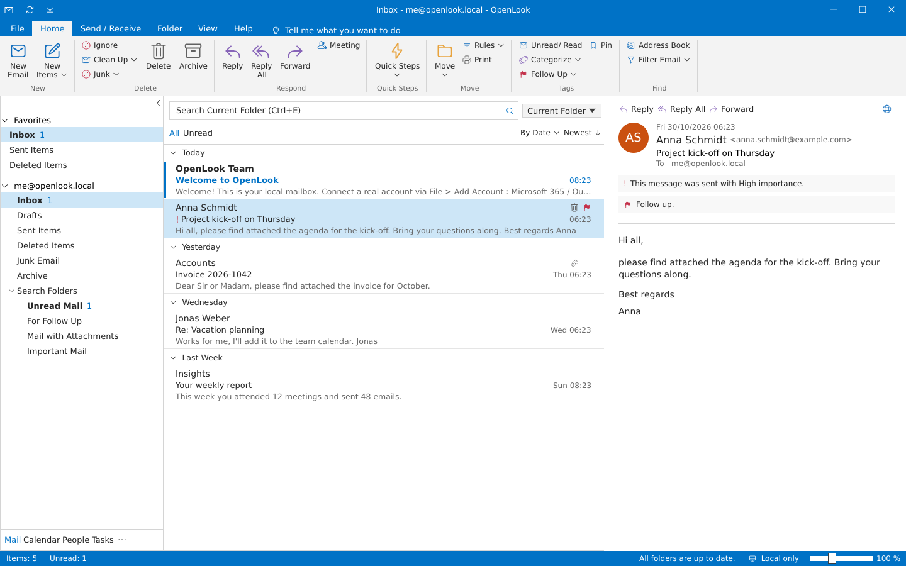
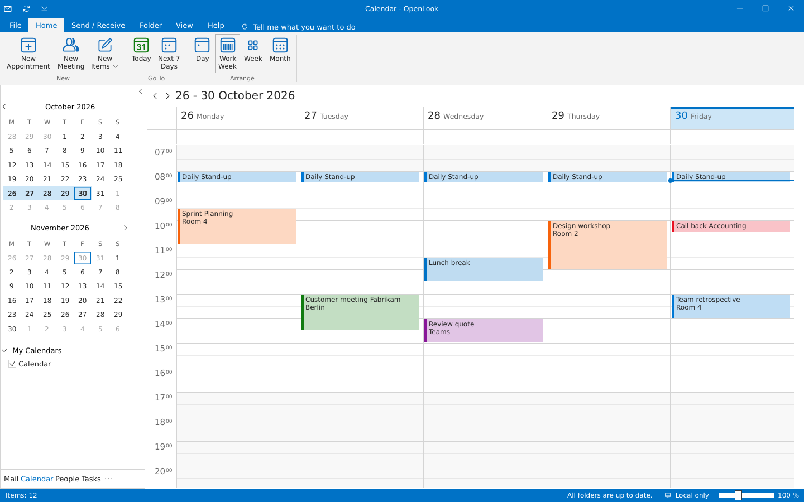
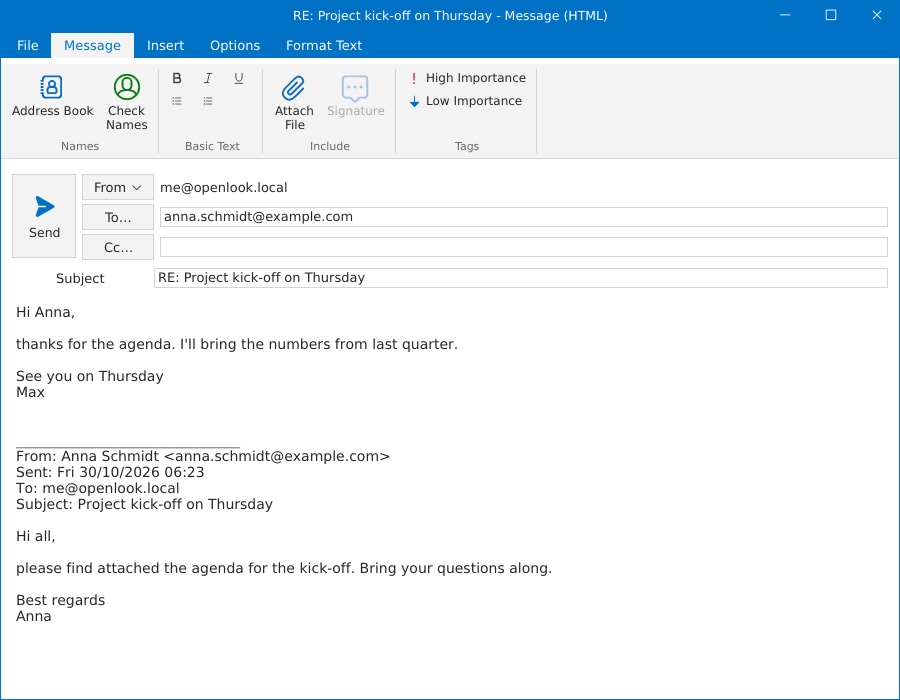
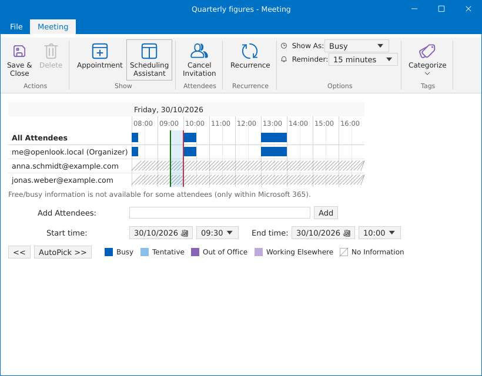
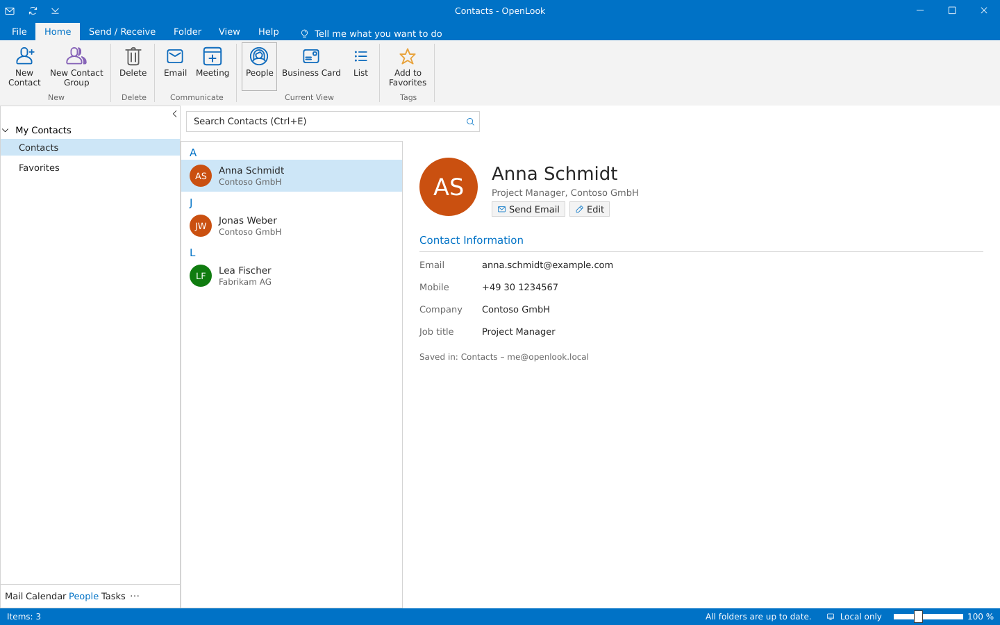
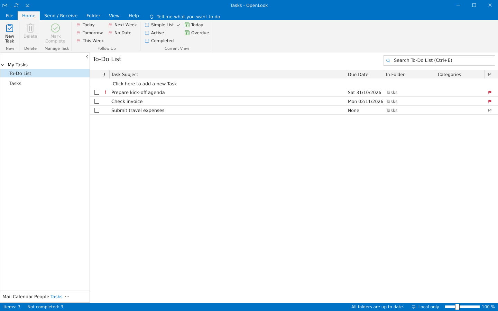

<div align="center">

# OpenLook

**A free clone of a well-known mail client – email, calendar, contacts and tasks in one desktop program.**

One native Rust program · no server · no browser · public domain (Unlicense)




</div>

> [!WARNING]
> **OpenLook is still untested.** It has not been used in everyday work and has only run in a test environment (Linux; the Windows build under Wine; IMAP/SMTP against a local test server; Microsoft 365 only against a simulated server). It has never been tried with a real Microsoft 365 account, on real Windows or on macOS. Please don't use it as the only program for important mailboxes, and keep backups. Bug reports are welcome.

## Why OpenLook?

* **Familiar from the first minute** – ribbon, folder pane, message list, reading pane, backstage, separate windows for messages and appointments, and the same keyboard shortcuts (`Ctrl+N`, `Ctrl+R`, `F9` …) as the original.
* **Everything in one program** – mail, calendar with Scheduling Assistant, people with contact groups, tasks, notes and journal.
* **Any mailbox** – IMAP/SMTP (Gmail, iCloud, Yahoo, GMX, Posteo, mailbox.org …) and Microsoft 365 / Outlook.com via Microsoft Graph, including shared mailboxes.
* **Fast and lean** – a single executable, local SQLite cache, network access in the background; passwords in the operating system's keychain.
* **Free** – public domain: anyone may do anything with it, no conditions. No telemetry, no ads.

## Screenshots

| | |
|:---:|:---:|
| <br>**Calendar** – work week, date navigator, categories | <br>**New message** – its own window with a ribbon |
| <br>**Scheduling Assistant** – free/busy and AutoPick | <br>**People** – contacts, business cards, contact groups |
| <br>**Tasks** – follow-up flags and views | |

## Quick start

```sh
git clone <this repository> openlook && cd openlook
cargo run --release
```

OpenLook starts with a local mailbox containing sample data. Add a real account with *File → Add Account*. `cargo build --release` produces a single file (`target/release/openlook`, on Windows `openlook.exe`).

## Features

### Window

* **Custom title bar** with a Quick Access Toolbar (Send/Receive, show/hide ribbon), window title "Inbox - account - OpenLook", minimise/maximise/close.
* **Ribbon** with the tabs *File · Home · Send / Receive · Folder · View · Help*, groups with large and small buttons, drop-down menus and "Tell me what you want to do"; the *Search* tab appears while searching (scope; refine by attachments, flagged, important, unread, categorized).
* **File backstage**: account information, Add Account, Account Settings (sync, remove), mailbox tools (empty Deleted Items), Options, Exit.
* **Folder pane** with Favorites, a folder tree per account (unread counts, drafts in [ ]) and Search Folders (Unread Mail, For Follow Up, Mail with Attachments, Important Mail), can be minimised; the navigation bar *Mail · Calendar · People · Tasks* at the bottom.
* **To-Do Bar** (View → To-Do Bar): calendar peek with upcoming appointments, favourite people and tasks.
* **Status bar** with items/unread, sync status, connection status and zoom slider.
* **Separate operating-system windows** as in the original for: reading a message, composing, appointment/meeting, contact, contact group, task, notes, options, Add Account and reminders.
* Office themes **Colorful** and **Black**.

### Modules

| Module | Features |
|---|---|
| **Mail** | HTML display (bold, italic, links, headings, lists, quotes, tables), open/save/save all attachments, conversation view, folder tree with subfolders, create/rename/delete folders, public/shared IMAP folders, rules, print (`Ctrl+P`), message list grouped by date (Today, Yesterday, weekday, Last Week …), All/Unread, sort by date/from/subject, search in the current folder or all mailboxes, reading pane right/bottom/off, message preview, Reply/Reply All/Forward, Delete → Deleted Items, Archive, Junk, Move (also drag & drop), Unread/Read, categories, follow-up flags, pin, double-click opens the message in its own window, original HTML in the browser, Quick Steps (Move to, To Manager, Team Email, Done, Reply & Delete, custom Quick Steps), Ignore and Clean Up conversations |
| **Compose** | Formatting (bold, italic, underline, bullets, numbering – shown formatted while typing and sent as HTML), attach files, forward with attachments, Send button on the left, From/To/Cc/Bcc, address book, Check Names, auto-complete from contacts, contact groups, signature, high/low importance, read and delivery receipts, "Reply to", Delay Delivery ("Do not deliver before", via the Outbox), insert business card, drafts, save as .eml, "Want to save your changes?" |
| **Calendar** | Date navigator (two months), Day/Work Week/Week/Month, Today, Next 7 Days, working hours highlighted, current-time line, overlapping appointments side by side, all-day events, show/hide calendars, appointments and meetings (attendees), Scheduling Assistant (free/busy grid for organiser and attendees, AutoPick of the next free slot, click the grid to move the meeting; attendees via Microsoft 365 `getSchedule`), recurring appointments (daily, weekly on weekdays, monthly, yearly, with/without end date), accept/tentative/decline meeting requests (Microsoft 365), Show As, reminders, categories |
| **Rules** | "Rules and Alerts": condition (sender, subject, recipient, body contains) → action (move, mark as read, flag, category, delete); applied to new messages after every Send/Receive, "Run Rules Now" for the whole Inbox |
| **Automatic Replies** | Out-of-office reply with a date range; Microsoft 365 with separate internal/external texts, IMAP accounts via ManageSieve (Sieve "vacation", e.g. Dovecot/Pigeonhole, Cyrus, mailbox.org, Posteo) |
| **Reminders** | Reminder window with Dismiss All, Open Item, Dismiss and Snooze |
| **People** | People, Business Card and List views; contact window with business card preview; favourites; contact groups (distribution lists) with their own window, suggested in the To field and expanded on send; email/meeting to a contact |
| **Notes** | Sticky notes in their own coloured windows that save themselves; Icon and Notes List views; colours |
| **Journal** | Journal entries (phone call, meeting, e-mail message, task, document, conversation, note) with a timer, list by entry type |
| **Tasks** | Table view with "Click here to add a new Task", due date, folder, follow-up (Today, Tomorrow, This Week, Next Week, No Date), views Simple List/Active/Completed/Today/Overdue, task window |

Keyboard shortcuts as in the original: `Ctrl+N` new item, `Ctrl+R` / `Ctrl+Shift+R` reply / reply all, `Ctrl+F` forward, `Del` delete, `Ctrl+Q` / `Ctrl+U` mark read / unread, `Insert` flag, `Ctrl+E` search, `Alt+S` send, `Ctrl+1…4` modules, `Ctrl+5` notes, `Ctrl+8` journal, `Ctrl+B/I/U` bold/italic/underline, `Ctrl+P` print, `F9` Send/Receive, `Ctrl+F1` ribbon. Notes and Journal are reached via "···" in the navigation bar.

## Accounts

* **Local mailbox** – always there, with sample data; works completely offline.
* **IMAP/SMTP** – any mailbox; servers are filled in automatically for Gmail, GMX, WEB.DE, T-Online, iCloud, Posteo, Yahoo, mailbox.org, freenet and AOL. IMAP over SSL/TLS (993), SMTP over STARTTLS (587) or SSL/TLS (465). Calendar, contacts and tasks of IMAP accounts are stored locally.
* **Microsoft 365 / Outlook.com** – via Microsoft Graph: mail (with subfolders), calendar, contacts and Microsoft To Do are synchronised; changes go straight to the server.
* **Shared mailboxes (Microsoft 365)** – *File → Account Settings → Add Shared Mailbox…*; they appear as a mailbox of their own in the folder pane (mail, calendar, contacts) and use your own sign-in.

### Setting up Microsoft sign-in

OpenLook uses the OAuth device code flow (no redirect, no client secret):

1. In the [Entra admin center](https://entra.microsoft.com) → *App registrations* → *New registration*.
   Account type: "Accounts in any organizational directory and personal Microsoft accounts".
2. Under *Authentication*, enable "Allow public client flows".
3. Under *API permissions* (Microsoft Graph, delegated) add
   `User.Read Mail.ReadWrite Mail.Send Calendars.ReadWrite Contacts.ReadWrite Tasks.ReadWrite MailboxSettings.ReadWrite offline_access`,
   and for shared mailboxes also `Mail.ReadWrite.Shared Mail.Send.Shared Calendars.ReadWrite.Shared Contacts.ReadWrite.Shared`.
4. Set the *Application (client) ID* as an environment variable and start OpenLook:

```sh
export OPENLOOK_GRAPH_CLIENT_ID=<client-id>
cargo run --release
```

Then *File → Add Account → Advanced options → Microsoft 365*, enter the code shown on Microsoft's page – done.

## Building

You need a current [Rust](https://rustup.rs) (stable). So far it has only been run on Linux and, as the Windows build, under Wine; macOS should build as well but has never been tried.

Building the Windows program on Linux (MinGW):

```sh
rustup target add x86_64-pc-windows-gnu
sudo apt install gcc-mingw-w64-x86-64
cargo build --release --target x86_64-pc-windows-gnu   # → target/x86_64-pc-windows-gnu/release/openlook.exe
```

On Windows the system font Segoe UI is used automatically. On Linux the usual desktop libraries are needed at run time (OpenGL, `libxkbcommon-x11` or Wayland).

| Variable | Default | Meaning |
|---|---|---|
| `OPENLOOK_DB` | `<data dir>/OpenLook/openlook.db` | Database path |
| `OPENLOOK_GRAPH_CLIENT_ID` | – | Client ID for Microsoft sign-in |
| `OPENLOOK_GRAPH_TENANT` | `common` | `common`, `organizations`, `consumers` or a tenant ID |
| `OPENLOOK_SYNC_MINUTES` | `5` | Interval for automatic Send/Receive |
| `OPENLOOK_CA_FILE` | – | Extra CA certificates (PEM) for mail servers with their own certificate authority |
| `OPENLOOK_GRAPH_URL` | `https://graph.microsoft.com/v1.0` | Graph endpoint (e.g. for national clouds) |

## Tests

```sh
cargo test                       # unit tests + the Microsoft 365 provider against a simulated Graph server
```

End-to-end against a real IMAP/SMTP server (send with attachment, fetch, flags, folders and subfolders, Deleted Items, rules, public folders with `OPENLOOK_IT_PUBLIC_FOLDER`, automatic replies via ManageSieve with a real auto-reply to a second account `OPENLOOK_IT_USER2/PASSWORD2/ADDRESS2`):

```sh
OPENLOOK_IT_HOST=mail.example.org OPENLOOK_IT_USER=… OPENLOOK_IT_PASSWORD=… OPENLOOK_IT_ADDRESS=… \
  cargo test -- --ignored imap_end_to_end
```

Keychain (needs a running Secret Service or the Windows Credential Manager):

```sh
cargo test -- --ignored keyring_roundtrip
```

## Code layout

```
src/
  main.rs            start-up: database, Tokio runtime, main window
  ui/
    mod.rs           main window: ribbon, folder pane, status bar, window management
    chrome.rs        title bar, ribbon building blocks, native child windows
    theme.rs         Colorful and Black themes
    mail.rs          mail module                   compose.rs    message window
    calendar.rs      calendar + appointment window  reminders.rs  reminders
    people.rs        people + contact window        tasks.rs      tasks + task window
    notes.rs         notes + journal                html.rs       HTML display, editor formatting
    rules_ui.rs      rules window                   quicksteps.rs Quick Steps
    groups.rs        contact groups                 todobar.rs    To-Do Bar
    scheduling.rs    Scheduling Assistant
    icons.rs         icons (generated by tools/gen_icons.py)
    backstage.rs     File backstage, options, Add Account, automatic replies
  providers/         imap.rs (IMAP/SMTP), graph.rs (Microsoft Graph), sieve.rs (ManageSieve), mod.rs (dispatch)
  conversation.rs    clean up / ignore conversations
  rules.rs           rule engine
  recur.rs           recurrence patterns
  secrets.rs         operating-system keychain
  db.rs              SQLite schema and queries
  mail.rs            MIME parsing, HTML → text
  seed.rs            sample data of the local mailbox
```

The UI only reads from the local database; everything that touches the network runs in the background so the window never freezes.

## Security

IMAP passwords and Microsoft tokens are kept in the operating system's keychain (Windows Credential Manager, macOS Keychain, Secret Service/GNOME Keyring/KWallet on Linux). If no keychain is available, they stay in the local database.

## Known limitations

* Formatting while composing is limited to bold, italic, underline and lists (no fonts, colours or inline images).
* Images in HTML mail are shown as placeholders in the reading pane; the original opens in the browser.
* The newest 100 messages per folder are cached.
* Meeting responses are only available for Microsoft 365 accounts. Automatic replies for IMAP need a server with ManageSieve (port 4190); the date range is per day there.
* Contact groups are stored locally.
* Free/busy times of other people come only from Microsoft 365; for IMAP accounts the Scheduling Assistant shows only your own calendar.
* Rules run in the client ("on this computer only"), i.e. only while OpenLook is open.
* Exchange public folders are not reachable via Microsoft Graph (Microsoft offers no Graph API for them); public IMAP folders are shown.
* Notes and journal are stored locally (Microsoft Graph has no API for them).

## License

OpenLook is public domain ([The Unlicense](LICENSE)): anyone may use, change, share and sell the code without any conditions – privately or commercially, without attribution. The icons are generated from [System UIcons](https://github.com/CoreyGinnivan/system-uicons) by Corey Ginnivan, which are public domain as well (Unlicense); the reply arrows were drawn for OpenLook.

OpenLook is an independent open-source project and is not affiliated with Microsoft. Microsoft, Outlook and Microsoft 365 are trademarks of Microsoft Corporation.
